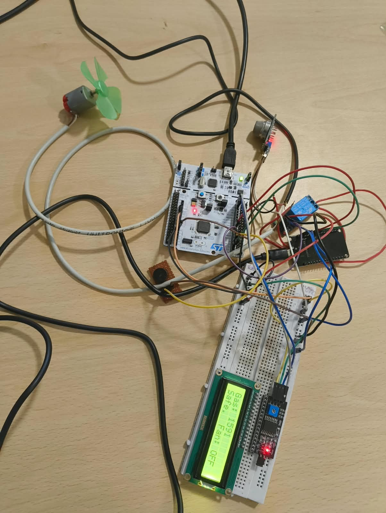
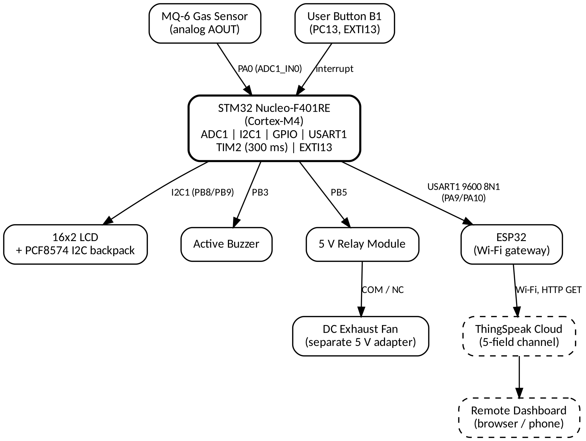
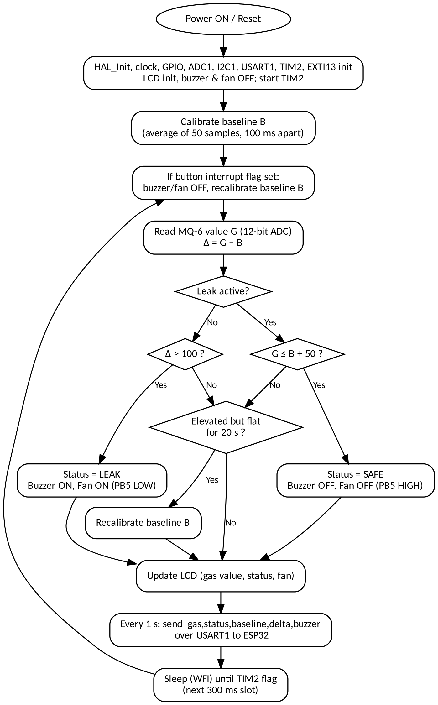
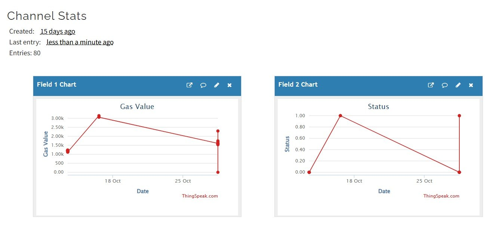
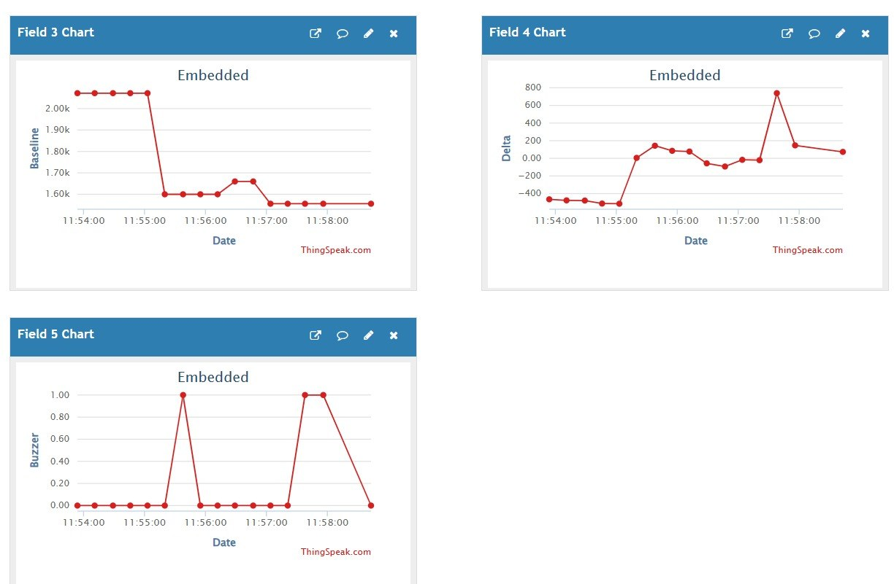
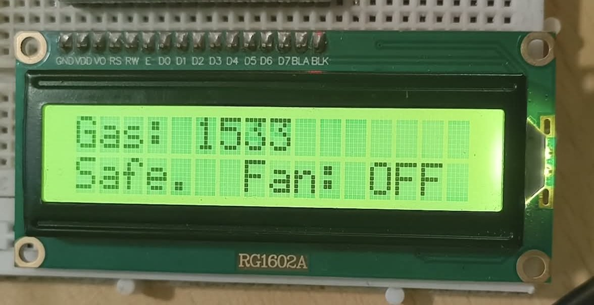
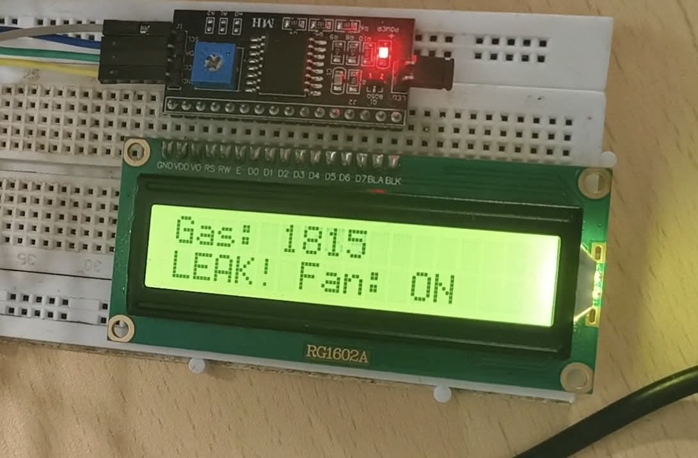

# Gas Leak Detection & Auto-Ventilation System (STM32 + ESP32)

Bare-metal-style firmware for an **STM32 Nucleo-F401RE** that monitors an MQ-6 gas sensor, raises a local alarm, switches an exhaust fan through a relay, and streams telemetry to **ThingSpeak** through an **ESP32** Wi-Fi bridge.

Course project for 23ELC302 (Embedded Systems), Amrita Vishwa Vidyapeetham, Coimbatore. Team of two.



## Features

- **Self-calibrating baseline:** averages 50 ADC samples at boot instead of using a fixed threshold, so it adapts to the sensor's warm-up and to ambient conditions.
- **Leak detection with hysteresis:** a leak is flagged at **baseline + 100 counts** and cleared only when the reading falls back within **50 counts** of the baseline, which prevents the alarm from chattering around the threshold.
- **Interrupt-driven timing:** a **TIM2** update interrupt (register level) sets a 300 ms sampling tick, and the main loop sleeps with `__WFI()` between samples.
- **Manual recalibration:** the Nucleo user button (B1, PC13) fires an **EXTI13** interrupt, with software debounce, that triggers a fresh baseline.
- **Automatic recalibration:** if a "leak" reading stays flat (within 50 counts) for 20 s, the system treats it as a drifted baseline and recalibrates.
- **Local outputs:** buzzer, relay-switched fan and a 16x2 I2C LCD (custom PCF8574 driver).
- **Cloud telemetry:** one CSV line per second over UART to an ESP32, which uploads 5 fields to ThingSpeak.

## System overview



```
MQ-6 --(ADC1 ch0)--> STM32F401RE --UART 9600--> ESP32 --Wi-Fi/HTTP--> ThingSpeak
                       |   |   |
                       |   |   +-- I2C --> 16x2 LCD (PCF8574)
                       |   +------ GPIO --> Relay --> Fan
                       +---------- GPIO --> Buzzer
                B1 button (PC13, EXTI13) --> recalibrate
```

## How it works

1. **Boot:** the LCD shows "Gas Monitor Init", then the firmware reads the MQ-6 50 times (100 ms apart) and stores the average as the baseline.
2. **Sampling:** TIM2 is configured at register level (PSC = 15999, ARR = 299, clocked from the 16 MHz HSI) to generate an update event every 300 ms. The ISR only sets a `sampleDue` flag. The main loop waits in `__WFI()` until that flag is set, then reads the ADC, updates the state machine and refreshes the LCD.
3. **Leak state machine:**
   - *Safe:* if `reading - baseline > 100`, enter *Leak*: buzzer on, fan on.
   - *Leak:* if `reading <= baseline + 50`, return to *Safe* (buzzer off, fan off). If the reading stays within 50 counts of the same value for 20 s, recalibrate the baseline and return to *Safe*.
4. **Recalibration button:** the EXTI13 ISR (falling edge on PC13, 200 ms debounce) sets `recalRequest`. The main loop handles it by switching outputs off and running the same 50-sample calibration.
5. **Telemetry:** once per second the STM32 sends `gasValue,status,baseline,delta,buzzer\n` over USART1 at 9600 baud. The ESP32 parses the line and uploads to ThingSpeak at most once every 16 s (free-tier limit).



## Hardware

| Part | Notes |
|---|---|
| STM32 Nucleo-F401RE | Main controller, 16 MHz HSI, no PLL |
| MQ-6 gas sensor | Analog output to ADC1 channel 0 (PA0) |
| ESP32 dev board | Wi-Fi bridge, UART2 on GPIO16 (RX) / GPIO17 (TX) |
| 16x2 LCD + PCF8574 I2C backpack | I2C address `0x27` (try `0x3F` if blank) |
| Relay module + fan | Fan wired to the relay's **NC** contact, so the logic is inverted (see below) |
| Buzzer | PB3 |

**Pin map (from the code)**

| Signal | Pin |
|---|---|
| MQ-6 analog out | PA0 (ADC1_IN0) |
| Buzzer | PB3 |
| Relay (fan) | PB5 |
| User button B1 | PC13 (EXTI13) |
| I2C1 (LCD) | as configured in CubeMX (SCL / SDA) |
| USART1 (to ESP32) | as configured in CubeMX (TX to ESP32 GPIO16, ESP32 GPIO17 to RX) |

> **Relay note:** the fan is connected to the relay's normally-closed contact because the NO contact on the module used was worn. The firmware therefore *de-energizes* the relay to turn the fan on. If you wire the fan to NO, swap `FAN_ON()` and `FAN_OFF()` in `main.c`.

## ThingSpeak fields

| Field | Content |
|---|---|
| 1 | Raw gas ADC value |
| 2 | Status (1 = leak, 0 = safe) |
| 3 | Current baseline |
| 4 | Delta (reading - baseline) |
| 5 | Buzzer state |




## Demo

| Safe | Leak detected |
|---|---|
|  |  |

## Repository layout

```
stm32/Core/Src/main.c       Application: ADC, TIM2, EXTI13, state machine, UART
stm32/Core/Src/i2c_lcd.c    HD44780 driver over PCF8574 (4-bit mode)
stm32/Core/Inc/i2c_lcd.h    LCD driver header
esp32/gas_leak_esp32/       Arduino sketch: UART parser + ThingSpeak uploader
docs/images/                Diagrams, photos and ThingSpeak screenshots
```

## Build and run

**STM32**
1. In STM32CubeIDE, create a project for **NUCLEO-F401RE** and enable ADC1 (IN0), I2C1, USART1 (9600 8N1) and PB3/PB5 as outputs.
2. Copy `main.c` and `i2c_lcd.c` into `Core/Src`, and `i2c_lcd.h` into `Core/Inc`, replacing the generated `main.c`.
3. Build and flash. `main.c` configures TIM2 and EXTI13 itself at register level.

**ESP32**
1. Open `esp32/gas_leak_esp32/gas_leak_esp32.ino` in the Arduino IDE (ESP32 board package installed).
2. Set `ssid`, `password` and your ThingSpeak **write API key** at the top of the file. Do not commit real credentials.
3. Upload, then wire STM32 TX to ESP32 GPIO16 and ESP32 GPIO17 to STM32 RX, with a common ground.

## Limitations and future work

- MQ-6 is a low-cost sensor that responds to several combustible gases and is affected by temperature and humidity. This is a prototype, not a certified safety device.
- The ADC is read in a polled conversion. DMA or ADC interrupts would free more CPU time.
- ThingSpeak's 15 s limit means the cloud graphs are coarser than the local 300 ms sampling.
- Possible additions: calibrated ppm estimate, watchdog timer, and MQTT instead of HTTP.

## Authors

Jyotika Sunil Balan and Sweta Nair C P.
